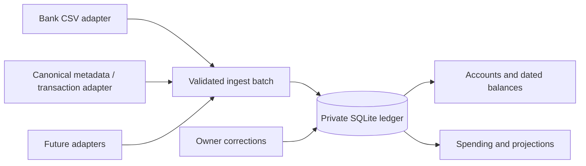

# Private state and account balances

SQLite is the durable store for a single owner and a single application writer.
`DATABASE_PATH` selects the private file. The container runs as UID 1000; the
data directory and database are private to that user. Local Compose uses a named
volume. Neither the volume nor any CSV is copied into the image or public Git tree.

The schema separates accounts and provider identifiers, categories and parent
relationships, counterparties, transactions, balance snapshots, source records,
import batches/rows, transaction corrections, and forecast settings. Foreign keys,
explicit transactions, WAL, a busy timeout and full synchronization protect
integrity. Source identifiers remain private; APIs use opaque IDs. Schema version
is recorded with `PRAGMA user_version`; newer unsupported schemas are refused.

Balances are dated facts, not sums reconstructed from an unknown opening balance.
Each account has one forecast role: `available`, `reserve` or `excluded`. Unknown
balances are null, distinct from zero. A combined account-derived forecast is
available only when every included account has a known balance for the same date.
Reserve totals cannot be negative. Available accounts may be overdrawn.

Historical internal transfers remain excluded from consolidated cash flow.
Changing an account's forecast role does not rewrite transaction classifications.
Planned transfers out of available cash into a reserve belong in the forecast's
monthly savings assumption; the app does not schedule internal transfers.

Owner settings and transaction corrections persist in SQLite across browsers and
restarts. The first local launch migrates earlier browser settings when the
database has none. Appearance remains a per-browser preference. API mutations
validate data and reject cross-origin requests. Remote deployment requires the
owner password/session configuration, even inside Tailscale.

## Backups

Use `node scripts/backup.mjs /private/destination.sqlite` inside the container.
It uses SQLite's online backup API, including committed WAL content, and writes
a private consistent snapshot. Do not copy a live database file without its WAL.
The command does not overwrite existing destinations. Backup snapshots contain
the owner's complete financial data and must be encrypted before offsite storage.

Production requires a tested restore and offsite backup destination, or an
explicitly approved recovery exception in private infrastructure documentation.
The public deployment templates are intentionally inactive until those gates,
private authentication, exact image digest, and tailnet device setup are reviewed.
See [deployment](../deploy/README.md).
